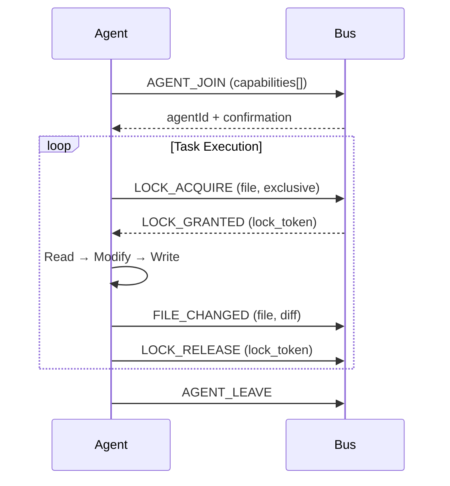

# 🤝 قواعد التنسيق بين الوكلاء — Noviq Agent Coordination Protocol

> **ملف مرجعي إلزامي** لجميع الوكلاء العاملين في مشروع Noviq.  
> أي وكيل ينضم إلى النظام **يجب** يقرأ هذا الملف ويلتزم بالقواعد أدناه قبل تنفيذ أي مهمة.

---

## 1. مبادئ أساسية (Core Principles)

| المبدأ | الوصف |
|----------|-------|
| **مركزية الاتصال** | لا يوجد اتصال مباشر بين الوكلاء — كل الرسائل تمر عبر **Message Bus** (`/api/agent-bus/*`). |
| **مصدر حقيقة واحد** | الـ Schema Registry في `.agent-system/schemas/` هو المرجع الوحيد للمحتوى، API، DB، والرموز التصمينية. |
| **قفل قبل تعديل** | أي كتابة على ملف مشترك تتطلب **Exclusive Lock** عبر `acquireLock()`. |
| **إشعار بالتغيير** | بعد أي تعديل ناجح، يرسل الوكيل `FILE_CHANGED` ليطلع الآخرون. |
| **إصدار تصاعدي** | كل تحديث للـ Schema يزيد رقم الإصدار (`version`) ويولد ETag جديد. |

---

## 2. دورة حياة الوكيل (Agent Lifecycle)



### 2.1. الانضمام (JOIN)
```js
// عند بدء المهمة
await sdk.join(['content-editing', 'schema-management']);
```

### 2.2. المغادرة (LEAVE)
```js
// عند الانتهاء أو الإنهاء
await sdk.leave();
// سيطلق الـ SDK جميع القفوف تلقائياً
```

### 2.3. Heartbeat
- الـ SDK يرسل `X-Agent-Name` header مع كل طلب.
- إذا انقطع الـ heartbeat لأكثر من **120 ثانية** → يُعتبر الوكيل ميتاً وتطلق قفله تلقائياً.

---

## 3. بروتوكول قفل الملفات (File Lock Protocol)

### 3.1. أنواع القفوف
| النوع | الاستخدام | يسمح بـ |
|------|----------|---------|
| **Shared (Read)** | قراءة ملفات مشتركة | قراءات متعددة متزامنة |
| **Exclusive (Write)** | كتابة/تعديل | وكيل واحد فقط، يمنع القراءات |

### 3.2. خطوات القفل الصحيحة
```js
// 1. طلب قفل حصري
const lock = await sdk.acquireLock('frontend/data/content.config.js', 'exclusive', 60, 'Updating services section');

try {
  // 2. قراءة المحتوى الحالي
  const current = await readFile(file);
  
  // 3. تطبيق التعديل
  const updated = modify(current);
  
  // 4. كتابة الملف
  await writeFile(file, updated);
  
  // 5. إشعار بالتغيير (اختياري لكن موصى به)
  await sdk.notifyFileChanged(file, 'updated', 'Updated services section');
  
} finally {
  // 6. إطلاق القفل دائماً (حتى عند الخطأ)
  await sdk.releaseLock(file, lock.lock_token);
}
```

### 3.3. التعامل مع التصادم (Lock Conflict)
- إذا رد الـ Bus بـ `409 LOCK_CONFLICT`:
  - اقرأ `locked_by` و `wait_suggestion` من الرد.
  - انتظر `wait_suggestion` ثوانٍ ثم أعد المحاولة.
  - **لا تحاول تجاوز القفل** — سيؤدي لطرد الوكيل الآخر وفقدان بياناته.

### 3.4. تجديد القفل (Renewal)
- للعمليات الطويلة (> 30 ثانية)، جدّد القفل دورياً:
```js
setInterval(async () => {
  await sdk.renewLock(file, lock.lock_token, 60);
}, 25000); // كل 25 ثانية
```

---

## 4. العمل مع Schema Registry

### 4.1. القراءة (Reading)
```js
// قراءة المحتوى الحالي للـ content schema
const { schema, version, etag } = await sdk.getSchema('content');
```

### 4.2. التحديث (Updating)
```js
// 1. اقفل ملف الـ schema نفسه
const lock = await sdk.acquireLock('.agent-system/schemas/content.json', 'exclusive', 60, 'Adding new field to services');

try {
  // 2. اقرأ الإصدار الحالي (للتحقق من التفاؤل)
  const { schema, version } = await sdk.getSchema('content');
  
  // 3. عدّل الـ schema
  schema.properties.services.items.properties.newField = { type: 'string' };
  schema.version = '1.3.0';
  
  // 4. أرسل التحديث مع الـ lock_token
  await sdk.updateSchema('content', schema, lock.lock_token);
  
  // 5. الـ Bus سيريح SCHEMA_UPDATED لجميع الوكلاء المهتمين
  
} finally {
  await sdk.releaseLock('.agent-system/schemas/content.json', lock.lock_token);
}
```

### 4.3. الخرائط: مورد → وكلاء مهتمون
| Schema Resource | الوكلاء المُستلمين لإشعار `SCHEMA_UPDATED` |
|-----------------|------------------------------------------|
| `content` | frontend, backend, debugger |
| `api-endpoints` | backend, architect, tester |
| `db-schema` | backend, debugger |
| `design-tokens` | frontend, reviewer |

---

## 5. أنواع الرسائل المدعومة (Message Types)

| النوع | المرسل | المستقبل | الاستخدام |
|------|--------|----------|----------|
| `AGENT_JOIN` | أي وكيل | Bus | تسجيل الدخول |
| `AGENT_LEAVE` | أي وكيل | Bus | تسجيل الخروج |
| `LOCK_ACQUIRE` | أي وكيل | Bus | طلب قفل |
| `LOCK_RELEASE` | أي وكيل | Bus | إطلاق قفل |
| `FILE_CHANGED` | أي وكيل | مستهدف أو الكل | إشعار بتغيير ملف |
| `SCHEMA_UPDATED` | أي وكيل | مهتمون بالخريطة أعلاه | تحديث Schema |
| `ERROR_REPORTED` | أي وكيل | Bus + Debugger | إبلاغ عن خطأ |
| `SCHEMA_VERSION_REQUEST` | أي وكيل | Bus | طلب إصدار schema |

---

## 6. قواعد خاصة بكل وكيل (Per-Agent Rules)

### 6.1. Frontend Agent
- **مسؤول عن**: `content.json` (قراءة)، `design-tokens.json` (قراءة/كتابة)
- **يقرأ**: محتوى الموقع من `content.config.js` أو Schema Registry
- **يكتب**: CSS tokens، مكونات UI، صفحات
- **يجب**: قفل `design-tokens.json` قبل أي تغيير على الألوان/الخطوط/المسافات

### 6.2. Backend Agent
- **مسؤول عن**: `api-endpoints.json` (قراءة/كتابة)، `db-schema.json` (قراءة/كتابة)
- **يقرأ**: العقود من `contracts/api/*.json` أو Schema Registry
- **يكتب**: مسارات API، migrations، middleware
- **يجب**: تحديث `api-endpoints.json` عند إضافة/تعديل endpoint، ثم `SCHEMA_UPDATED`

### 6.3. Architect Agent
- **مسؤول عن**: العقود في `contracts/api/*.json`، `api-endpoints.json`
- **يقرأ**: المتطلبات، الـ schemas الموجودة
- **يكتب**: عقود جديدة، يحدّث OpenAPI spec
- **يجب**: بعد كتابة العقد، أرسل `SCHEMA_UPDATED` لـ `api-endpoints`

### 6.4. Debugger Agent
- **مسؤول عن**: قراءة `content.json`، `db-schema.json` للتشخيص
- **يقرأ**: logs، errors، stack traces
- **يكتب**: تقارير الأخطاء عبر `ERROR_REPORTED`
- **يجب**: إبلاغ الأخطاء الحرجة فوراً مع `severity: 'critical'`

### 6.5. Tester Agent
- **مسؤول عن**: قراءة `api-endpoints.json`، `db-schema.json` لكتابة الاختبارات
- **يقرأ**: العقود، الـ schemas
- **يكتب**: اختبارات وحدة، تكامل، E2E
- **يجب**: التحقق من صحة العقود مقابل الكود الفعلي

### 6.6. Reviewer Agent
- **مسؤول عن**: قراءة `design-tokens.json`، `content.json` للتدقيق
- **يقرأ**: الكود، الـ tokens، إمكانية الوصول
- **يكتب**: تقارير التدقيق، اقتراحات التحسين
- **يجب**: قفل `design-tokens.json` عند اقتراح تغييرات على التصميم

### 6.7. Ultra Plan / Ultra Build
- **مسؤول عن**: تنسيق المهام، إنشاء الخطط، تقسيم العمل
- **يقرأ**: جميع الـ schemas للحالة الحالية
- **يكتب**: خطط التنفيذ، تكليفات الوكلاء
- **يجب**: إرسال `LOCK_ACQUIRE` لكل وكيل قبل تكليفه بملف

---

## 7. معالجة الأخطاء والمرونة (Error Handling & Resilience)

### 7.1. إعادة المحاولة (Retry Logic)
```js
async function withRetry(fn, maxAttempts = 3, baseDelay = 1000) {
  for (let attempt = 1; attempt <= maxAttempts; attempt++) {
    try {
      return await fn();
    } catch (err) {
      if (attempt === maxAttempts) throw err;
      const delay = baseDelay * Math.pow(2, attempt - 1) + Math.random() * 100;
      await new Promise(r => setTimeout(r, delay));
    }
  }
}
```

### 7.2. Fallback للقراءة
- إذا فشل `getSchema()` → اقرأ الملف مباشرة من `.agent-system/schemas/` كـ fallback
- سجل الخطأ عبر `reportError()` مع `severity: 'medium'`

### 7.3. انقطاع الاتصال
- إذا انقطع SSE → أعد الاتصال تلقائياً مع `since=lastSeq`
- الـ Bus يحتفظ بـ 500 حدث أخير في الذاكرة

---

## 8. اختبار التكامل (Integration Testing)

### 8.1. سيناريوهات مطلوبة
1. **Lock Contention**: وكيلان يحاولان قفل نفس الملف → واحد ينجح، الآخر ينتظر
2. **Schema Update Propagation**: تحديث `content` → frontend و backend يتلقيان الإشعار
3. **Agent Crash Recovery**: وكيل يموت أثناء القفل → القفل يطلق بعد TTL
4. **Concurrent Readers**: عدة وكلاء يقرؤون نفس الملف بـ Shared Lock → ينجح الجميع
5. **Network Partition**: انقطاع مؤقت → الوكيل يعيد المحاولة مع backoff

### 8.2. أوامر الاختبار
```bash
# من جذر المشروع (C:\Downloads\Noviq - final)

# اختبار شامل لنظامcoordination: 23 حالة
node .agent-system/test-message-bus.js

# اختبار تكاملي عبر HTTP الحقيقي (من مجلد backend)
cd backend && node tests/agent-bus-smoke.test.js   # 25 حالة
```

> `message-bus.js` **ليس خادماً مستقلاً** — بل Express router يُركَّب داخل
> `backend/app.js` على المسار `/api/agent-bus`. لتشغيله شغّل الخادم الخلفي
> المعتاد (`cd backend && node index.js`) ثم استخدم المسارات أعلاه.

---

## 9. المراقبة والتشخيص (Observability)

### 9.1. Health Check
```bash
curl http://localhost:4322/api/agent-bus/health
# Response: { status: 'healthy', agents: 6, schemas: 4, locks: 2, ... }
```

### 9.2. قائمة الوكلاء النشطين
```bash
curl http://localhost:4322/api/agent-bus/agents
```

### 9.3. سجل الأحداث (Event Log)
```bash
tail -f .agent-system/events/recent-events.log
```

### 9.4. حالة القفوف
```bash
curl -X POST http://localhost:4322/api/agent-bus/lock?action=status \
  -H "Content-Type: application/json" \
  -d '{"file": "frontend/data/content.config.js", "agent": "frontend"}'
```

---

## 10. التحديثات المستقبلية (Future Extensions)

- [ ] **Redis Backend** للـ Lock Manager في الإنتاج (أداء أعلى، توزيعي)
- [ ] **WebSocket Support** بالإضافة لـ SSE (للاتصال ثنائي الاتجاه)
- [ ] **Agent Dashboard** واجهة ويب لمراقبة الوكلاء والقفوف والـ schemas
- [x] **Audit Trail** تسجيل كامل لجميع العمليات للتدقيق — مسارات `/message` و`/lock`
      معاً تكتب في سجل الأحداث (مع `X-Correlation-ID` للربط)
- [ ] **Conflict-Free Replicated Data Types (CRDTs)** للـ content.config.js للدمج التلقائي

---

## 11. مراجع سريعة (Quick Reference)

### أهم endpoints
| العملية | endpoint | الطريقة |
|----------|----------|---------|
| انضمام وكيل | `/api/agent-bus/message` | POST (type: AGENT_JOIN) |
| طلب قفل | `/api/agent-bus/lock?action=acquire` | POST |
| إطلاق قفل | `/api/agent-bus/lock?action=release` | POST |
| قراءة Schema | `/api/agent-bus/schema/{resource}` | GET |
| تحديث Schema | `/api/agent-bus/schema/{resource}` | PUT |
| تدفق الأحداث | `/api/agent-bus/events` | GET (SSE) |
| حالة الوكلاء | `/api/agent-bus/agents` | GET |
| صحة النظام | `/api/agent-bus/health` | GET |

### متغيرات بيئة مقترحة
```env
AGENT_BUS_URL=http://localhost:4322
AGENT_NAME=frontend
AGENT_TIMEOUT=10000
```

---

**تم تحديث هذا البروتوكول في:** 2026-09-26  
**الإصدار:** 1.0.0  
**المسؤول:** Ultra Worker (Meta-Orchestrator)