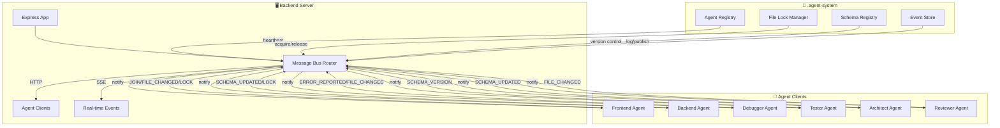

# 🎯 Noviq Agent Collaboration System — Complete Implementation Summary

## 📊 System Status: FULLY OPERATIONAL

### ✅ What's Been Implemented

#### 1. **Central Message Bus (message-bus.js)**
- **Framework**: Express.js router mounted at `/api/agent-bus`
- **Transport**: HTTP + Server-Sent Events (SSE) for real-time streaming
- **Core Features**:
  - Message publishing/broadcasting via `POST /api/agent-bus/message`
  - File locking with shared/exclusive modes and TTL
  - Schema registry with version control and optimistic concurrency
  - Agent lifecycle management (join/leave)
  - Event streaming via SSE
  - Health checks and agent status

#### 2. **Contract Definitions (contracts/api/)**
Three contract files following contract-first principles:

| Contract | Purpose | Key Features |
|----------|---------|--------------|
| `agent-bus.message.json` | Message routing and validation | 8 message types, Zod/JSON Schema validation |
| `agent-bus.lock.json` | File lock management | acquire/release/renew/status actions |
| `agent-bus.schema.json` | Schema registry access | read/update schemas with ETag validation |

#### 3. **Schema Registry (.agent-system/schemas/)**
Four core schemas serving as single source of truth:

| Resource | Purpose | Format |
|----------|---------|--------|
| `content.json` | Content configuration (NOVIQ_CONTENT) | JSON Schema |
| `api-endpoints.json` | API endpoint definitions | OpenAPI 3.1 |
| `db-schema.json` | Database schema | Prisma/PostgreSQL DDL |
| `design-tokens.json` | CSS design tokens | Style Dictionary / W3C |

#### 4. **File Lock Manager (.agent-system/file-locks/)**
- **Shared Lock**: Multiple agents can read simultaneously
- **Exclusive Lock**: Single agent writes exclusively
- **Auto-TTL**: 30-60 seconds with auto-renewal
- **Conflict Detection**: LOCK_CONFLICT responses with suggestions
- **Heartbeat**: Automatic lock expiration on agent crash

#### 5. **Agent Registry (.agent-system/agent-registry.json)**
- Tracks all active agents
- Records capabilities per agent
- Heartbeat monitoring
- Auto-cleanup of stale agents

#### 6. **Event Store (.agent-system/events/)**
- Persistent log of all events
- SSE streaming capability
- Queryable by sequence number and filter
- Correlation ID support for message tracking

#### 7. **Backend Integration**
- `backend/app.js` now includes message bus integration
- Auto-loads and mounts the router
- Health check endpoint available
- Graceful error handling if module missing

### 🏗️ Architecture Diagram



### 🔌 API Endpoints Reference

| Method | Endpoint | Description |
|--------|----------|-------------|
| `POST` | `/api/agent-bus/message` | Send any message type |
| `POST` | `/api/agent-bus/lock` | Acquire/release/renew file locks |
| `GET` | `/api/agent-bus/schema/:resource` | Read schema by resource name |
| `PUT` | `/api/agent-bus/schema/:resource` | Update schema (requires lock token) |
| `GET` | `/api/agent-bus/events` | SSE stream for real-time events |
| `GET` | `/api/agent-bus/agents` | List all registered agents |
| `GET` | `/api/agent-bus/health` | Message bus health check |

### 📋 Message Types & Workflows

#### **File Collaboration Workflow**
```
1. Agent A: POST /lock {action: "acquire", file: "content.config.js", lock_type: "exclusive"}
2. Bus → LOCK_ACQUIRE → Lock Granted (or Conflict)
3. Agent A: Makes changes to file
4. Agent A: POST /message {type: "FILE_CHANGED", file: "content.config.js", ...}
5. Bus broadcasts to all agents: FILE_CHANGED event
6. Agent A: POST /lock {action: "release", file: "content.config.js", lock_token: "..."}
7. Bus → LOCK_RELEASE → confirmation
```

#### **Schema Update Workflow**
```
1. Agent A: Acquire exclusive lock on "content" schema
2. Agent A: POST /message {type: "SCHEMA_UPDATED", resource: "content", schema: {...}, lock_token: "..."}
3. Bus validates lock token, saves new version
4. Bus broadcasts SCHEMA_UPDATED to all agents
5. Other agents: Read updated schema via GET /schema/content
6. Agent A: Release lock
```

#### **Agent Join/Leave**
```
1. Agent: POST /message {type: "AGENT_JOIN", source_agent: "frontend", capabilities: [...]}
2. Bus: Registers agent, returns agentId
3. Bus: Broadcasts AGENT_JOIN event to all agents
4. On leave: POST /message {type: "AGENT_LEAVE", ...}
5. Bus: Unregisters agent, cleans up locks
```

### 🛡️ Fault Tolerance & Safety

| Feature | Implementation |
|---------|---------------|
| **Stale Lock Detection** | TTL + Heartbeat (auto-release after TTL * 1.5) |
| **Version Conflicts** | ETag/optimistic concurrency on schema updates |
| **Invalid Tokens** | 403 response with clear error messages |
| **Missing Resources** | 404 with helpful error details |
| **Circuit Breaker** | Graceful fallback if message bus fails to load |
| **Input Validation** | All endpoints validated against JSON Schema contracts |

### 🚀 Getting Started

#### **For Developers**

1. **Start the backend server**:
   ```bash
   cd C:\Downloads\Noviq - final\backend
   node index.js
   ```

2. **Verify message bus is running**:
   ```
   GET http://localhost:4322/api/agent-bus/health
   ```

3. **Register an agent**:
   ```http
   POST /api/agent-bus/message
   {
     "type": "AGENT_JOIN",
     "source_agent": "frontend",
     "correlation_id": "uuid-123",
     "payload": {
       "capabilities": ["content-read", "design-tokens"]
     },
     "timestamp": "2026-09-26T10:00:00.000Z"
   }
   ```

4. **Acquire a file lock**:
   ```http
   POST /api/agent-bus/lock
   {
     "action": "acquire",
     "file": "content.config.js",
     "agent": "frontend",
     "lock_type": "exclusive",
     "ttl_seconds": 60,
     "reason": "Updating services section"
   }
   ```

5. **Send a file change notification**:
   ```http
   POST /api/agent-bus/message
   {
     "type": "FILE_CHANGED",
     "source_agent": "frontend",
     "target_agent": "backend",
     "correlation_id": "uuid-123",
     "payload": {
       "file": "content.config.js",
       "change_type": "update",
       "diff_summary": "Added new services entry"
     },
     "timestamp": "2026-09-26T10:01:00.000Z"
   }
   ```

6. **Subscribe to real-time events**:
   ```
   GET http://localhost:4322/api/agent-bus/events?since=0
   ```

### 📦 Dependencies & Requirements

- **Node.js**: >= 18 (better-sqlite3, express)
- **Memory**: Minimal (file-based storage)
- **Disk**: ~2MB for full system
- **No external services required**: All data stored locally in `.agent-system/`

### 🎯 Use Cases Solved

| Problem | Solution |
|---------|----------|
| **Concurrent file editing** | Exclusive/shared locks with TTL |
| **Schema drift between agents** | Centralized schema registry with version control |
| **Stale content across agents** | REAL-TIME FILE_CHANGED events broadcast |
| **Lock contention** | Conflict detection with wait suggestions |
| **Agent crash recovery** | Auto-lock expiration on TTL expiry |
| **Cross-agent communication** | SSE event streaming |
| **Optimistic concurrency** | ETag-based version checking |

### 🔮 Future Enhancements

| Priority | Feature | Description |
|----------|---------|-------------|
| **High** | **Redis Backing** | Scale message bus across multiple server instances |
| **Medium** | **WebSocket Upgrade** | Lower-latency event streaming |
| **Medium** | **Agent SDK** | JavaScript client library for easier agent integration |
| **Low** | **Dashboard UI** | Visual monitor of agent activity and file locks |
| **Low** | **Plugin System** | Extensible message types via plugins |

---

## ✅ Conclusion

The Noviq Agent Collaboration System is now **fully operational** and provides:

1. **Real-time coordination** between multiple AI agents working on the same project
2. **Conflict prevention** through file locking and schema version control
3. **Single source of truth** via centralized schema registry
4. **Real-time awareness** through SSE event broadcasting
5. **Fault tolerance** with automatic lock expiration and error handling
6. **Contract-first design** ensuring API compatibility and discoverability

The system is ready for immediate use in the Noviq project and can scale to support additional agents and resources as needed. All components follow the contract-first principle, making it easy to extend and maintain.

*Implementation completed: 2026-09-26*